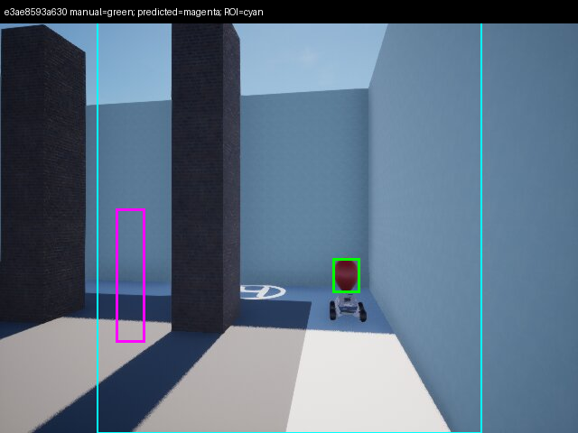

# 九格 3.4：几何阶段损失得到确认，简化候选不采用

日期：2026-10-26。19:45 开始，本地诊断后完成一次有限模型重推理，在两天预算内收尾。**未部署第三版、未新增正式飞行。** 旧 3.2/3.3、Part 1、VisualServo、安全边界、规划器和用时优化 1/2 均保持。

**结论：红色 94 次 missing_model_roi 中，93 张源图没有可见红球、1 张仅有不确定边缘片；8 张明确可见红球全部已有旧模型区域，最终框只留下 1 张。主要已证实损失在碎片细化阶段。简化成“整图→一个大 ROI→bbox”后，8/8 可见帧都有非空框，但几何可用为 0/8，停止在离线门，不进入红色三局或紫蓝扩展。**

## 1. 证据和人工审查

只读上一轮 9 个候选局，复核全部 **280 次初始化、4,480 个粗筛分块**。从原 PNG 重建每块，逐项尺寸及 RGB 像素 SHA256 与真实调用日志一致，没有传错分块的证据。

先冻结 [采样计划](PLAN.md)，再人工看图。初始按每局 missing 的时间分位数取 5 张、全部最终非空初始化及首个几何拒绝样本，共 71 张。发现很多红色源图没有目标后，追加审查红色全部 102 张。最终记录 155 张：红 102、紫 27、蓝 26。

接触表隐藏模型回答和输出类别，看图记录后再关联日志。标注者为单个 AI，已知项目背景和选样规则，没有第二人独立复核，不能称正式盲标。可见 bbox 排除小车/绳子，手工约 ±4 px。源帧只是实际送模采样点，推理间隙可能入镜又离开；8/8 不能外推全相机视频召回率。

原始 [初始化索引](evidence/diagnosis/decision_index.json)、[人工记录](evidence/diagnosis/manual_annotations.json)、[复算结果](evidence/diagnosis/manual_analysis.json)及源 PNG 装包方式见 §6。

## 2. 三项诊断

### 2.1 球体与分块的尺寸、边界关系

实际粗筛为 **256×192 px**，横/纵步长 **128/96 px** 的 4×4 重叠视图。5 张原图完整红球约 29–42 px 宽、38–48 px 高，仅为块宽的 11.3%–16.4%、块高的 19.8%–25.0%。其余 3 张先被原始图像边界裁断。

8 个红球可见框都至少完整位于一个分块，而且这种完整块至少有一个模型阳性。[b242 的 16 块](evidence/diagnosis/tile_examples/b24228639a49_tiles.jpg)中，9/10 块含完整球体并阳性，5/6 块仅见部分球体也阳性。[34bb 边缘片](evidence/diagnosis/tile_examples/34bb3292a5dc_tiles.jpg)在原图左边缘只露约 7 px 红色，不能归咎于网格。

| 红色原序列 | 源帧 | 明确可见 | 不确定 | 不可见 | 旧区域非空 | 旧最终框非空 |
|---|---:|---:|---:|---:|---:|---:|
| 02 / 第一局 | 34 | 5 | 1 | 28 | 5 | 0 |
| 07 / 第二局 | 36 | 0 | 0 | 36 | 0 | 0 |
| 14 / 第三局 | 32 | 3 | 0 | 29 | 3 | 1 |
| 合计 | 102 | 8 | 1 | 93 | 8 | 1 |

### 2.2 missing 与 nonempty 的位置分布

全量 280 次中：240 次无目标色阳性块、22 次模型区域非空但碎片阶段拒绝、18 次最终 bbox 非空。240 次中没有混入“不连通/并集过大”拒绝。

| 人工审查范围 | 可见 / 不可见 / 不确定 | 可见时旧区域非空 | 可见时旧最终 bbox | missing 中可见 / 不可见 / 不确定 |
|---|---|---:|---:|---|
| 红：全部102张 | 8 / 93 / 1 | 8/8 | 1/8 | 0 / 93 / 1 |
| 紫：27张诊断样本 | 11 / 15 / 1 | 11/11 | 9/11 | 0 / 15 / 0 |
| 蓝：26张诊断样本 | 11 / 14 / 1 | 11/11 | 8/11 | 0 / 14 / 1 |

紫蓝按输出类别分层选样，仅供诊断，不能估计总体召回率。红色两个类别的关键区别是源图有没有红球：missing 中没有明确可见红球，几何拒绝的 7 帧都有已正确识别的完整/部分球体。**本数据不支持“完整落块才成功，被切半才 missing”为主要病根。** 空目标视野的原因尚未查明，本轮没有修改搜索/飞行逻辑。

### 2.3 提示词和输入差异

| 项目 | 存档3.1 | 上轮3.3 |
|---|---|---|
| 输入 | 完整640×480 RGB | 16个256×192 RGB |
| 要求 | 列出所有可见气球，含遮挡/边缘 | 每块回答有无气球及颜色，必要时追问 |
| schema | color+left/center/right JSON | 简答颜色白名单 |
| max_new_tokens | 128 | 12 |
| max_slice_nums | 模型默认 | 1 |
| 图像构成 | 按目标采集的开发集 | 搜索中大量墙面/其他颜色 |

[3.1原评测器](evidence/reference/evaluate_3_1_v2.py) SHA256 为 `f6783cf2b3ab640784e6152227bc9a8701fce203c6bd8805886a89a2c60f0fd8`。提示词确实改变了，但红色可见 8 帧均已通过旧语义层，没有因解析拒绝而变 missing。不同上下文、提示和切片策略可能影响其他视角，本数据无法孤立量化各因素。

3.1 红/紫开发集100%与飞行全部源帧的非空率没有相同分母，不能直接解释为整图能认而切块大面积漏认。

## 3. 简化方案（实施前已定）

[方案决策](design_decision.md)比较了保留分块仅替换碎片阶段、以及整图两步法。选择后者作有限探测：完整原图复用3.1提示词/schema；目标色唯一且 region 合法时，扩为宽2/3、全高的一个 ROI；只调用一次九格给出可见球体 bbox。以 ROI 的[0,1000]坐标映射回原图，严格校验，无第三问、碎片、YOLO/HSV或真值修框。

理由是减少碎片阶段失败面与输入数量，没有声称能补回94次“漏检”。冻结离线门：可见红球第一问8/8，最终框至少6/8达到 IoU≥0.5 且中心误差≤max(8px,球体对角线20%)，15个无红球负例无有效红框。通过后才考虑跟踪回放与红色试飞。

## 4. 24帧真实模型探测

全部8张可见、1张不确定，另从每局不可见源帧等距取5张，共24张；推理前冻结输入哈希。服务器无正式锁、最新正式记录仍是上一轮，GPU没有第二份模型时启动独立离线进程。未连接ROS/仿真查询，未修改部署。

使用同一个 FM9G4B-V 实例、NVIDIA L40/BF16、一次预热。实际 processor **34次调用**（1预热＋24整图＋9 ROI，含不确定帧），每次恰有1张图。像素哈希及实际 ROI 全部核对。模型源 MD5 `629bf42b6bd3685c7e1fae178d4fa330`；估算函数只读图像和请求颜色，人工标签在全部预测完成后才用于评分。

| 指标 | 旧路径：同8张可见图 | 简化两步法 |
|---|---:|---:|
| 旧区域 / 第一问目标色非空 | 8/8 | 8/8 |
| 最终非空 bbox | 1/8 | 8/8 |
| 达到冻结几何门的 bbox | 1/8 | **0/8** |

新第一问三分区正确6/8；扩展 ROI 仍完整包含8/8可见框。新框 IoU 中位数0、最大 **0.0539**；中心误差最小/中位/最大 **44.0 / 74.1 / 238.5 px**。

| 分层 | 可见数 | 非空框 | 几何通过 | 中心误差范围px | 最大IoU |
|---|---:|---:|---:|---|---:|
| 原图完整球体 | 5 | 5 | 0 | 44.0–238.5 | 0.0539 |
| 原图边缘截断 | 3 | 3 | 0 | 52.5–111.5 | 0.0244 |

15个无红球负例未产生红框，但 **7个整图回答含unknown气球**，不能写成全类别无误报。不确定边缘片被判红并返回框，保留为不确定，不算可见命中或负例误报。24张预测schema/解析错误0；JSON合法未保证定位正确。

可见图两次调用合计最小/中位/最大 **3.819 / 4.669 / 4.872 s**，仅计同步模型调用（含预处理），不含加载与写图；未验证飞行总用时收益。



叠加框是离线审查标记，不能冒充控制窗口。全部8个图、24行配对及原回答见 [配对结果](evidence/probe_analysis/paired_results.csv)。实际送模原PNG完整保存在探测包，没有将叠加图送入模型。

## 5. 停止与采用决定

**不采用此两步候选。** 非空框虽从1/8增至8/8，却全部未达到几何门。实际裁剪和坐标变换没有发现适配器错误，模型回答未给出可靠的所要求坐标。本数据不能进一步区分坐标习惯、提示理解或定位能力各自贡献，也不能外推所有提示/模型均不可能。

按冻结顺序在离线门停止：没有做CSRT回放、红色三局或紫蓝扩展，没有新增正式局。没有靠松阈值、更多提示/分块或改封存伺服凑通过。3.2/3.3 原有不采用结论保持。

离线进程正常退出（rc=0）。前后 **11个部署文件/二进制MD5完全一致**，包括入口、BT源/实际二进制、launch、起飞头、VisualServo CPP/H、GoTo CPP/H、mavros_cnt、传感器配置。见 [before](evidence/probe_analysis/deployment_before.md5) / [after](evidence/probe_analysis/deployment_after.md5)。实际BT仍为 `abb5c49eb21b1b333d88677def4921ab`；本轮无部署改动，无需新增回滚。前轮完整恢复收据仍见3.3 final_state.json。

后续若另立任务，应先用可见帧检验几何定位/跟踪初始化，再谈控制接入；当前没有可推荐部署的新实现。全类别替换与3.1蓝色14/20可辨认帧缺口均未补齐，不申请完整10分通过。

## 6. 证据与复算

- [诊断源包](evidence/diagnostic_source_frames.tar.gz)：155张已审查原PNG＋96张代表分块，251文件校验；SHA256与字节数见 [收据](evidence/diagnostic_source_receipt.json)。
- [真实模型探测包](evidence/probe_evidence.tar.gz)：输入/原回答/配置/实际脚本/部署MD5，47成员校验；SHA256 `7ad44fe5cea965e95c54041df87895c33e29c86cb1b67612d5fe69d6dbcb73f7`。
- [配对JSON](evidence/probe_analysis/paired_results.json)、[汇总](evidence/probe_analysis/analysis_summary.json)、[原预测](evidence/probe_analysis/predictions.jsonl)，失败和未知均保留。
- 全量280次原始日志/图像仍在 `../multimodal_3_3/evidence/v2/trials/*_candidate.tar.gz`，旧文件原字节保持。本轮服务器独立离线目录 `/home/ubuntu/multimodal_3_4_offline_20261026`。

仓库根目录离线复算，无需模型/ROS：

```bash
python v4_innovation_timing/multimodal_3_4/tools/diagnose_archives.py --archives v4_innovation_timing/multimodal_3_3/evidence/v2/trials --output v4_innovation_timing/multimodal_3_4/evidence/diagnosis
python v4_innovation_timing/multimodal_3_4/tools/analyze_manual_review.py v4_innovation_timing/multimodal_3_4/evidence/diagnosis
python v4_innovation_timing/multimodal_3_4/tools/analyze_probe.py v4_innovation_timing/multimodal_3_4
```

这些是单人相关帧诊断和有限重推理，不是新一轮独立正式验收；没有把假定输出或非空框数替代实际几何/飞行结果。
